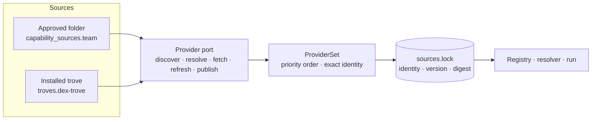

# Capability sources

Ananke doesn't depend on one catalog. Skills and agents can come from **your own folders**, from an installed
**trove** such as [Dex Trove](https://neo-pragnya.github.io/Dex-Trove/), or from both, all through one provider
port. The harness owns what happens next: resolution policy, activation and execution.



## What a provider may and may not do

| Operation | Gives you | Never does |
| --- | --- | --- |
| `discover` | descriptors with source, namespace, name, version, digest, licence and facets | run instructions or tools |
| `resolve` | one exact descriptor and its digest | guess between two capabilities with the same name |
| `fetch` | the bytes, after checking the digest | activate anything because it was downloaded |
| `refresh` | a new index snapshot | change a lock that already exists |
| `publish` | a receipt, on a writable source with a named approver | write to a read-only source, or overwrite a published capability |

Every failure has a stable code that you can branch on: `NOT_FOUND`, `AMBIGUOUS`, `VERSION_NOT_FOUND`,
`DIGEST_MISMATCH`, `NOT_CACHED`, `PATH_ESCAPE`, `NAMESPACE_COLLISION`, `READ_ONLY`, `NOT_APPROVED`,
`VERSION_CONFLICT` or `SOURCE_UNAVAILABLE`.

## Add your own folder

Any folder of skills (each a directory with `SKILL.md`, `AGENT.md` or `ananke.yaml`) can be a source:

```toml
# .ananke/config.toml
[capability_sources.team]
root = "../team-skills"     # relative to the project, or absolute
namespace = "acme"          # every capability from this folder is acme/<name>
writable = false            # true allows reviewed publishes into it
```

- **Bytes are read, never run.** Scripts inside a skill aren't executed during discovery or fetch.
- **The folder is a boundary.** Paths can't escape it, and neither can symlinks; an escape is refused as `PATH_ESCAPE`.
- **Unknown stays unknown.** A skill without a `version`, `license` or `description` is reported with those
  fields listed as `unknown`. Ananke doesn't invent them, and it doesn't turn `allowed-tools` prose into
  permissions.
- **Normalised metadata lives beside the bytes.** Each descriptor has a sidecar (`ananke/source-sidecar@1`) with
  source, namespace, relative path, digest, kind, licence, declared requirements and unknown fields. The source
  folder itself is never written to.

## Add a private Git repository

```toml
[capability_sources.platform]
type = "git"
url = "https://git.example.com/platform/skills.git"   # no credentials in the URL
commit = "4f1c…"            # a full 40-character commit: branches and tags can move under a lock
root = "skills"             # subfolder inside the repository
namespace = "platform"
credential_env = "PLATFORM_GIT_TOKEN"   # the *name* of a variable that holds the token
```

- **Pinned.** Only a full commit sha is accepted (`UNPINNED_SOURCE` otherwise), and later commits upstream never
  change what the pin serves.
- **Credentials by reference.** The token is read from the named variable at fetch time and handed to Git through
  the environment. It never appears in config, URLs, sidecars, locks or logs. A token in the URL is refused
  (`CREDENTIAL_IN_URL`), and a missing variable is `CREDENTIAL_MISSING`.
- **Nothing runs.** Git hooks, LFS smudge filters and submodules are disabled during the fetch.
- **Offline after the first fetch.** The commit is cached under `.ananke/sources/<id>/<commit>/` and served from
  there with no network. If neither the cache nor the remote is available, the error is `SOURCE_UNAVAILABLE`.
  There is no fallback to another source with a similar name.

## Add a trove

Installed troves are switched on as before:

```toml
[troves.dex-trove]
enabled = true
```

The trove is read as data: its catalog, facets and release ledger. Ananke asks the trove's `ananke.troves` entry
point where it lives **only when the trove is enabled**. A project without troves never imports a trove package,
and that is tested. Older releases resolve from the trove's release ledger. If the installed trove no longer holds
those bytes, `fetch` fails with `NOT_CACHED` instead of substituting another version.

## Use it

```bash
ananke registry providers list                       # sources in priority order
ananke registry providers discover "debug"           # across every source
ananke registry providers resolve systematic-debugging
# [AMBIGUOUS] systematic-debugging exists in several sources (team:acme/systematic-debugging,
#   dex-trove:superpowers/systematic-debugging); name the source, e.g. team:acme/systematic-debugging
ananke registry providers resolve team:acme/systematic-debugging --lock sources.lock.json
ananke registry providers check-lock sources.lock.json
```

References are `[source:]namespace/name[@version|@sha256:digest]`. Display names never take part in identity.

## Locks

`--lock` writes exact identity, version and digest. `check-lock` fetches each entry and verifies the digest:

- **A refresh doesn't move a lock.** Refreshing a source mid-run changes discovery, not what's locked.
- **A changed digest is an error.** If the bytes behind a locked version change, the check fails with
  `DIGEST_MISMATCH`. Resolve again on purpose to take the new bytes.
- **Conflicts are explained.** Locking a second version of the same identity fails with `VERSION_CONFLICT`,
  naming both versions and digests and the two ways forward.

## Related

- [Registry guide](registry-guide.md): learning, versions, policy and the main `ananke.lock`.
- [Dex Trove](dex-trove.md): the optional trove, and `dex ananke handoff` for exact pins chosen in Dex.
