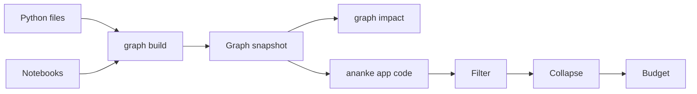

# Code graph

`ananke graph build` reads your Python files and notebooks and records what's in them and how they connect. It reads
source as text and never runs any of it.



## What's in it

| Node | Id | Notes |
| --- | --- | --- |
| File or notebook | `file:<path>` | notebooks add `notebook: true` and their cell counts |
| Function, class, method | `function:<path>:<name>`, `class:<path>:<name>`, `method:<path>:<Class>.<name>` | line range, one-line doc and signature |
| Data file | `data:<path>` | `exists` says whether the file is in the repository now |

| Edge | Meaning | Origin |
| --- | --- | --- |
| `owns`, `imports` | a file defines a symbol or imports a module | extracted |
| `calls`, `inherits` | resolved through the file's own definitions and imports | inferred |
| `reads`, `writes` | a call names a data file with a literal path | inferred |

Every edge records where it came from. `pkg/core.py:12` is a line in a file, and `nb/study.ipynb#cell=3:2` is line 2 of
the notebook's third cell, counting markdown cells.

Adding a notebook or data file never changes the id of an existing Python symbol.

## Notebooks

Code cells are read in order as one module, so a function in one cell can be called from another. Top-level calls
belong to the notebook file.

| Cell contains | What happens |
| --- | --- |
| Line magics and shell lines (`%matplotlib`, `!pip`) | ignored; the rest of the cell is read |
| `%%time`, `%%timeit`, `%%capture`, `%%prun` | the body is read as Python |
| Top-level `await` | read as Python |
| Any other cell magic (`%%bash`, `%%writefile`) | left out, listed in `unparsed_cells` and counted in `cell_magics` |
| Python that doesn't parse | left out, listed in `unparsed_cells` |

A notebook that can't be read at all, or an old-format one, gets `parse_error: true`, and the build continues. A notebook
in another language is listed with its `language` and not parsed.

## Data edges

Reads and writes are recognised from common calls such as `pd.read_csv("x.csv")`, `df.to_parquet("y.parquet")`,
`open("z.json", "w")` and `Path("z.json").read_text()`.

**What isn't included:**

- Computed paths (`pd.read_csv(name)`, f-strings), because a graph can only state what the source states.
- URLs, absolute paths and paths outside the repository.
- Files without a recognised data suffix.

A relative path is tried from the notebook's folder first in a notebook, and from the repository root first in a module.
If the file doesn't exist either way, the node has `exists: false` and the first choice is its path.

## Impact

`ananke graph impact` follows these edges too: changing a module reaches notebooks that import or call it, and changing
a data file reaches the code that reads it.

## Reading it from a product

```bash
ananke app code --path src/ --kind function --query parse
ananke app code --budget 200
ananke app code --collapse file
ananke app code --collapse directory --depth 2
```

Nothing here changes the workspace. There's one graph: this is a view of the snapshot, not a second copy.

**Budget.** `--budget` caps the nodes returned (500 by default). Over budget, the most connected nodes stay, with ties
broken by id, and `truncated` is true.

**Collapse.** `file` and `directory` group nodes and sum the edges between groups. Each summed edge has its `count`, a
count per kind and per origin, and up to five source locations. To expand a group, ask again with `--path`.

**Nothing vanishes silently.** `edge_accounting` says where every edge touching your selection went:

| Field | Meaning |
| --- | --- |
| `shown` | in `edges`, or summed into them |
| `inside_a_group` | both ends are in one collapsed group |
| `to_nodes_not_shown` | one end is outside the selection or over budget |
| `external_imports` | imports of third-party modules, with nothing here to draw them to |

An import of a module in this repository points at its file, with the module name kept in `via_module`.

## Stable output

`content_digest` identifies the graph's content and leaves out when it was built. The same sources always give the same
digest, so it can tell you whether anything changed.
