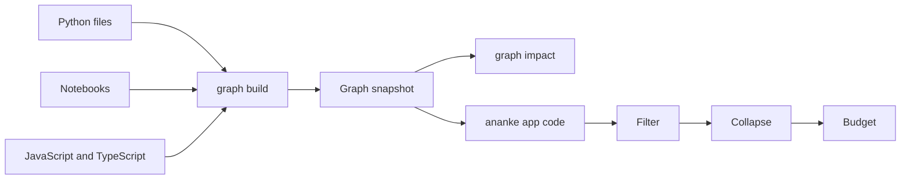

# Code graph

`ananke graph build` reads your Python, notebooks, JavaScript and TypeScript and records what's in them and how they
connect. It reads source as text and never runs any of it.



## What's in it

| Node | Id | Notes |
| --- | --- | --- |
| File or notebook | `file:<path>` | notebooks add `notebook: true` and their cell counts; JavaScript and TypeScript files add `language` |
| Function, class, method | `function:<path>:<name>`, `class:<path>:<name>`, `method:<path>:<Class>.<name>` | line range, one-line doc and signature |
| Data file | `data:<path>` | `exists` says whether the file is in the repository now |

| Edge | Meaning | Origin |
| --- | --- | --- |
| `owns`, `imports` | a file defines a symbol or imports a module | extracted, or `ambiguous` for an import two files could satisfy |
| `calls`, `inherits` | resolved through the file's own definitions, imports and re-exports | inferred |
| `reads`, `writes` | a call names a data file with a literal path | inferred |

Every edge records where it came from. `pkg/core.py:12` is a line in a file, and `nb/study.ipynb#cell=3:2` is line 2 of
the notebook's third cell, counting markdown cells.

Adding a notebook, script or data file never changes the id of an existing Python symbol.

## How imports become links

An import edge's `target` is always the name the source used, such as `module:app.db`, `module:..services.orders` or
`module:react`. When that name means a file in this repository, `resolved_target` holds `file:<path>`.

**Python.** A module's name depends on its source root, and a repository can have several, so roots are worked out from
the code: the folder above a top-level package (`backend` for `backend/app/__init__.py`), `src`, and any folder with a
`pyproject.toml`, `setup.py` or `setup.cfg`. A file's `source_root` metadata names its root. An import is looked for:

1. In the importing file's own root, then the folders above it. This is how two demos in one repository can each have
   their own `agents` package.
2. In one other root that holds that package, or is declared or named `src`.
3. For a dotted name, in one other folder, even with no `__init__.py`.

Relative imports are worked out from the file's folder, and one that climbs out of the repository stays unresolved.
`from pkg import module` links to the module, and `from pkg import name` links to the package.

**JavaScript and TypeScript.** Relative paths try the exact file, then extensions, then `/index`, and `./x.js` may mean
`x.ts`. `paths` and `baseUrl` come from the nearest `tsconfig.json`, `jsconfig.json` or `tsconfig.*.json`, following
`extends` inside the repository. Anything else is a package, kept as `module:<package>`.

**What can still be wrong:**

- Two files that fit equally well aren't guessed between. The edge has origin `ambiguous`, no `resolved_target`, and no
  calls resolved through it.
- A standard library name only resolves to a local file when a real package shadows it. A sibling module named like a
  third-party package can still be taken for that package when its folder has no `__init__.py`.
- Bundler aliases set only in a build config (such as `vite.config.ts`), workspace packages found through
  `package.json`, and Vue, Svelte or Astro files aren't read.
- Dynamic dispatch isn't followed. A TypeScript call through a field works when the field's class is declared, as in
  `constructor(private api: ApiService)` and `this.api.send()`.

## Notebooks

Code cells are read in order as one module, so a function in one cell can be called from another. Top-level calls
belong to the notebook file.

| Cell contains | What happens |
| --- | --- |
| Line magics and shell lines (`%matplotlib`, `!pip`) | ignored; the rest of the cell is read |
| `%%time`, `%%timeit`, `%%capture`, `%%prun` | the body is read as Python |
| Top-level `await` | read as Python |
| Any other cell magic (`%%bash`, `%%writefile`) | left out, listed in `unparsed_cells` and counted in `cell_magics` |
| Python that doesn't parse | left out, listed in `unparsed_cells` |

A notebook that can't be read at all, or an old-format one, gets `parse_error: true`, and the build continues. A notebook
in another language is listed with its `language` and not parsed.

## JavaScript and TypeScript

`.js`, `.jsx`, `.ts`, `.tsx`, `.mjs` and `.cjs` files are read without Node. Comments and strings can't create edges, and
line numbers hold.

| Read | How |
| --- | --- |
| Functions | declarations, and top-level `const` arrow or function values, including `memo(() => …)` |
| Classes and methods | top-level classes, their methods and arrow-function properties |
| Imports | ES imports, re-exports, `require` and `import()` with a literal path |
| Calls | names resolved through imports and the file's own definitions, `this.method()`, and CommonJS exports |

Top-level calls belong to the file, because that's where these files wire things together.

**What's left out:** `.d.ts` files, minified files, anything over 2 MB, and the folders `node_modules`, `dist`, `build`,
`out`, `vendor`, `vendored`, `third_party`, `bower_components` and `coverage`. A file that can't be read gets
`parse_error: true`, and the build continues.

The 2 MB limit applies to Python too. A Python file over it, or one nested too deeply to parse, is listed with
`parse_error: true`.

## Data edges

Reads and writes are recognised from common calls such as `pd.read_csv("x.csv")`, `df.to_parquet("y.parquet")`,
`open("z.json", "w")` and `Path("z.json").read_text()`.

**What isn't included:**

- Computed paths (`pd.read_csv(name)`, f-strings), because a graph can only state what the source states.
- URLs, absolute paths and paths outside the repository.
- Files without a recognised data suffix.

A relative path is tried from the notebook's folder first in a notebook, and from the repository root first in a module.
If the file doesn't exist either way, the node has `exists: false` and the first choice is its path.

## Impact

`ananke graph impact` follows these edges too: changing a module reaches the files and notebooks that import, call or
inherit from it, wherever they sit, and changing a data file reaches the code that reads it.

## Reading it from a product

```bash
ananke app code --path src/ --kind function --query parse
ananke app code --budget 200
ananke app code --collapse file
ananke app code --collapse directory --depth 2
```

Nothing here changes the workspace. There's one graph: this is a view of the snapshot, not a second copy.

**Budget.** `--budget` caps the nodes returned (500 by default). Over budget, the most connected nodes stay, with ties
broken by id, and `truncated` is true.

**Collapse.** `file` and `directory` group nodes and sum the edges between groups. Each summed edge has its `count`, a
count per kind and per origin, and up to five source locations. To expand a group, ask again with `--path`.

**Nothing vanishes silently.** `edge_accounting` says where every edge touching your selection went:

| Field | Meaning |
| --- | --- |
| `shown` | in `edges`, or summed into them |
| `inside_a_group` | both ends are in one collapsed group |
| `to_nodes_not_shown` | one end is outside the selection or over budget |
| `external_imports` | imports with no file here to draw them to: third-party modules, and ambiguous or unresolved names |

An import of a module in this repository points at its file through `resolved_target`, with the name the source used
kept in `via_module`.

## Stable output

`content_digest` identifies the graph's content and leaves out when it was built. The same sources always give the same
digest, so it can tell you whether anything changed.
