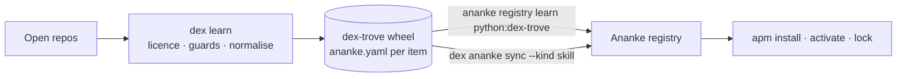

# Dex Trove: a skill library for your registry

[Dex Trove](https://neo-pragnya.github.io/Dex-Trove/), the *trove of dexterities*, is a licence-clean library of
agent artifacts for Ananke. It provides **970 items** (skills, agents, instructions, hooks, workflows and plugins),
learned from open repositories such as `github/awesome-copilot`, `anthropics/skills` and `obra/superpowers`, plus
first-party skills. Each item is admitted only if its own licence allows redistribution, and ships with a
strict `ananke.yaml` manifest and full provenance (upstream repo, pinned commit, licence evidence).

Ananke is the harness: registry, resolution, policy, activation and evidence. Dex Trove is content you load into it.



## Load everything

```bash
pip install "ananke-plexus[dex]"     # same as: pip install ananke-plexus dex-trove
ananke registry init
ananke registry learn python:dex-trove
```

The Python importer reads the installed wheel's `RECORD` and registers every `ananke.yaml` found up to four path
parts deep (`dex_trove/<kind>/<namespace>.<name>/ananke.yaml`). It never imports the package.

A small number of security-teaching items contain credential-*shaped* placeholders (for example
`api_key="PINECONE_API_KEY"`). Ananke's secret scanner refuses those by default, so this command reports them as
`denied` and exits `1`. Everything else is registered. To get a clean exit, use `dex ananke sync` (below), which
skips them.

## Load a curated slice

```bash
dex ananke sync --project .                               # everything except secret-flagged items
dex ananke sync --project . --kind skill --kind agent     # by kind
dex ananke sync --project . --source superpowers          # by source namespace
dex ananke sync --project . --name awesome-copilot/git-commit
dex ananke sync --project . --dry-run
```

`dex ananke sync` stages the selected items and runs `ananke registry learn` on them. The `ananke` CLI is the
contract: Dex never writes the registry directly. Re-running is idempotent; unchanged items are `skipped`.

## What arrives

| Dex kind | Ananke kind | Notes |
| --- | --- | --- |
| skill | `skill` | |
| agent | `agent` | `instructions.ref` points at the agent file |
| instruction, prompt | `prompt` | tag `instruction` for instructions |
| hook | `tool` | code-bearing: no `permissions` declared, so Ananke warns until reviewed |
| workflow | `workflow` | |
| plugin | `bundle` | `members` are `ananke://<kind>/<ns>/<name>` references |

Every item arrives as trust `discovered` in channel `candidate`. Items without code declare empty permissions
explicitly; items with scripts leave them unset, so Ananke's `missing-permissions` warning prompts a review.

```bash
ananke registry search debugging
ananke registry resolve awesome-copilot/arize-ax --explain    # bundle → member skills
ananke apm install superpowers/systematic-debugging --activate
ananke registry promote superpowers/systematic-debugging --trust approved --reviewed-by you
```

## Tighten the policy

Dex admits only redistributable licences. Your project can narrow that further:

```toml
# .ananke/registry/policy.toml
[licenses]
allow = ["MIT", "Apache-2.0"]
allow_unknown = false

[permissions]
forbid = ["shell.execute"]
```

## Upgrade

```bash
pip install -U dex-trove
ananke registry learn python:dex-trove      # new immutable versions only where content changed
ananke apm upgrade --dry-run
```

Each Dex item has its own SemVer, bumped only when its upstream content changes, so upgrades are quiet and
reviewable.

## Roadmap: `[troves]`

A planned policy setting will make installed troves load automatically:

```toml
[troves]
dex-trove = { enabled = true, kinds = ["skill", "agent"], sources = ["*"], channel = "candidate" }
```

Dex Trove already exposes the `ananke.troves` entry point that Ananke will use to discover trove packages
generically.

See the Dex Trove docs for the [licence policy](https://neo-pragnya.github.io/Dex-Trove/docs/concepts/licence-policy/)
and the [full integration guide](https://neo-pragnya.github.io/Dex-Trove/docs/guides/ananke-integration/).
