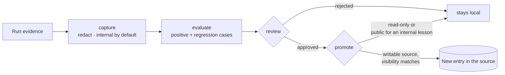

# Learning candidates

Sometimes a run teaches something worth keeping, such as "freeze the clock and seed randomness before re-running a
flaky test". Ananke can turn that into a **candidate**: a reusable skill with evidence. It becomes capability
memory only after evaluation and review.




## From a session to a draft

```bash
ananke learning draft --base main -o lesson.md          # what the session changed, decided and broke
ananke learning draft --base main --run run-1a2b -o lesson.md
ananke learning overlap lesson.md                       # does Dex Trove already have it?
```

`draft` writes a lesson to finish by hand: the commits, the decisions written in their messages, the tests that
failed (from JUnit reports) and the warnings of the runs you name, plus the files involved. It holds names and
messages only, never file contents, and it never overwrites a draft. Fill in *When this applies* and *Technique*,
then capture it as below; capture redacts secrets and paths.

`overlap` searches Dex Trove for the lesson's main words and scores each result by the words they share. Without Dex
it says it couldn't check, never that nothing is similar.

## The steps

```bash
ananke learning capture freeze-time \
  --description "Stabilise a flaky test by freezing time and seeding randomness. Use when a test fails intermittently." \
  --body lesson.md \
  --case "pos:positive:pytest tests/test_checkout.py -q" \
  --case "reg:regression:pytest -q" \
  --run run-4f2a…
ananke learning evaluate freeze-time --allow-commands    # each case must exit 0
ananke learning review freeze-time --approve --reviewer "Lead" --reason "general, safe"
ananke learning promote freeze-time --to team --approved-by "Lead"
ananke learning list                                     # what still blocks each candidate
```

## What keeps it safe

- **Project data stays private.** A candidate holds only the lesson's text. No source files are copied. Secrets are
  redacted and the text is scanned again; anything left refuses the capture. Absolute workspace and home paths
  become `<workspace>` and `~`.
- **Internal by default.** Only `--public` candidates can go to sources marked `visibility = "public"`.
- **Evaluation is opt-in.** The cases' commands run only with `--allow-commands`, in the workspace, with a timeout, and
  without a shell: pipes, `&&` and redirects aren't interpreted. Put anything longer in a script.
- **Promotion is gated.** It needs at least one positive and one regression case, every case passing, an approving
  review **newer than the evaluation**, and a writable destination. Each refusal names every reason.
- **Nothing is overwritten.** Promotion publishes a new entry through the [provider port](capability-sources.md);
  an existing capability with that name is a `VERSION_CONTENT_CONFLICT`.

## Sending a lesson to Dex Trove

The candidate folder (`SKILL.md`, `evaluation.json`, `review.json`) is in the format Dex Trove's own gate reads. An
installed trove is read-only to Ananke, so promote it with Dex instead:
`dex candidate publish .ananke/learning/candidates/freeze-time --to <source>`, then `dex learn`.
