# See It in Action

Animated walkthroughs of Ananke Plexus doing real work. The terminal panels replay genuine output from Ananke
Plexus 0.3.5, run against a small sample project. Long tables are condensed and paths are shown relative to the
project. The flow diagrams turn the infographics into numbered stories: follow the moving packet, and read the step
sentence under the title.

!!! tip "Prefer a still picture?"
    Each animation respects your system's *reduce motion* setting and shows its final frame instead.

---

## From zero to verified evidence

Install the CLI, initialise a project, turn a ticket into a locked spec, map the code, check the blast radius of a
change, then verify. The first `verify` blocks on a missing `tests/` folder. Adding a test clears it, and the
evidence bundle is written.

The commands are covered in [Getting Started](getting-started.md) and the [CLI Commands](../reference/commands.md)
reference.

---

## From intent to implementation

The spec-driven pipeline. Every stage leaves an artifact, so you can always trace code back to the decision that
asked for it. When requirements change, the dashed loop (step 10) shows the rule: update the spec, regenerate, and
execute again.

---

## Autonomy with boundaries

The Hermes loop that keeps long-running agent work moving. Failures lead to recovery rather than dead ends. Every
step runs inside the execution controls: permission scopes, tool allowlists, policy checks and approval gates.

---

## Precise context from the code graph

Rather than reading the whole repository, an agent asks the graph what a change touches. It gets back a focused
subgraph with direct and indirect impact, plus the tests to run. See [Code Graph Intelligence](../concepts/graph.md).

---

## Trust every change from laptop to production

Three gates and one evidence bundle. A failed check stops the change where it happens, and the fix goes round
again. See [Policy Engine & Security](../concepts/policy-security.md).

The same guardrails at work in a terminal: hooks on every commit, and policy rules that explain themselves.

---

## Give your agents a skill library

Install [Dex Trove](dex-trove.md), learn it into the registry and find a skill. The resolver then explains why it
picked a given version. 961 of the 970 items register. The other 9 contain placeholder credentials, which the
secret scanner refuses by design.

---

## How these are made

The animations are generated from code, so they stay accurate as Ananke changes:

- **Terminal walkthroughs**: `docs/assets/flows/src/walkthroughs.py`, rendered by `term_flow.py` from the
  `living-diagrams` skill.
- **Flow diagrams**: `docs/assets/flows/src/concepts.py`, rendered by the `marvellous-aws-architecture-docs` skill's
  concept-card mode.

Both skills ship in [Dex Trove](https://neo-pragnya.github.io/Dex-Trove/). Each spec file starts with the command
that rebuilds it.
