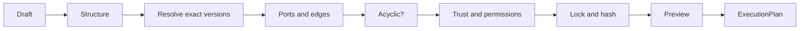

# Workflow assembly

A workflow draft is a JSON graph: nodes name exact capability versions, and edges connect an output port to an input
port. Ananke validates it against the registry and compiles it to its existing `ExecutionPlan`. There is no second
scheduler, registry or policy engine.

> [!IMPORTANT]
> Assembly stops at the compiled plan. Ananke has no command that runs a compiled workflow yet. The scheduler refuses
> to run a capability step without an executor: the step fails rather than reporting success.



## A draft

```json
{
  "schema_version": "1.0.0",
  "workflow_id": "team/api-verification",
  "nodes": [
    {"id": "extract", "capability_ref": "team/api-extract@1.0.0", "kind": "tool",
     "inputs": [{"name": "source", "schema_ref": "python-source/v1"}],
     "outputs": [{"name": "openapi", "schema_ref": "openapi/v3"}],
     "permission_profile": ["filesystem-read"]},
    {"id": "plan", "capability_ref": "team/api-tests@2.1.0", "kind": "skill",
     "inputs": [{"name": "openapi", "schema_ref": "openapi/v3"}],
     "outputs": [{"name": "tests", "schema_ref": "test-plan/v1"}],
     "approval_class": "PLAN", "retries": 1}
  ],
  "edges": [{"id": "e1", "source": "extract", "source_port": "openapi", "target": "plan", "target_port": "openapi"}]
}
```

```bash
ananke app workflow-validate draft.json     # every problem, each with a code and a next step
ananke app workflow-preview draft.json      # order, locked versions, permissions, approvals, plan hash
ananke app workflow-compile draft.json      # the ExecutionPlan
ananke app workflow-suggest draft.json plan openapi --candidate team/other@1.0.0
```

## The rules

| Rule | Code when broken |
| --- | --- |
| Only fields and kinds the draft format defines are allowed, so no setting is silently ignored | `INVALID_DRAFT` |
| References pin an exact version, and any `#sha256:` digest matches | `UNPINNED_REF`, `UNRESOLVED_REF`, `DIGEST_MISMATCH` |
| Node and edge ids are unique, and edges name real nodes and ports | `DUPLICATE_ID`, `UNKNOWN_NODE`, `UNKNOWN_PORT` |
| An edge joins ports with the same `schema_ref` | `PORT_MISMATCH` |
| Required inputs are bound, once unless the port accepts `multiple` | `UNBOUND_INPUT`, `DUPLICATE_BINDING` |
| The graph has no cycles; retries are a node setting, not a loop | `CYCLE` |
| Ports a capability declares must match the draft | `PORT_CONTRACT_MISMATCH` |
| Trust and lifecycle pass registry policy | `UNTRUSTED`, `LIFECYCLE_BLOCKED` |
| `permission_profile` covers what the capability needs | `PERMISSION_NOT_GRANTED` |

**Nothing is converted for you.** Markdown never silently satisfies a SARIF input. Add an explicit node that converts it.

**Inputs of an entry node** (one nothing feeds) are supplied when the workflow runs, and the preview lists them as
`workflow_inputs`. Mark a port `"required": true` if it must be bound by an edge.

## Trust comes from the registry

Identity, trust, lifecycle and permissions are read from the registry record for that exact version. A draft can't raise
them. `permission_profile` is an upper bound: a capability that needs a permission outside it is rejected, and listing a
permission grants nothing the capability didn't declare.

A capability declares typed ports in its manifest (`inputs.native.ports`, `outputs.native.ports`). Where it doesn't, the
draft's ports are only the draft's claim, and validation warns `PORTS_UNVERIFIED`.

## Stable plans

The plan hash covers the workflow id, each node's digest, ports, configuration, approvals, permissions and retries, the
edges and the compiler version. Node order, title and UI data don't change it. The same draft and the same versions
always give the same plan and hash.

## Suggestions explain; they never act

`workflow-suggest` says which candidates could feed an input port, why the others can't, and, separately, which are
authorized under policy. A capability can be compatible and still not authorized. It never adds a node, activates
anything or changes the draft.

## Nothing runs

Validating, previewing, suggesting and compiling start no process, make no network call, install nothing and write
nothing to the workspace.
