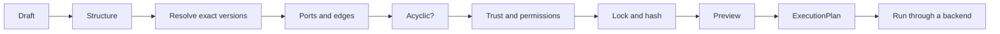

# Workflow assembly

A workflow draft is a JSON graph: nodes name exact capability versions, and edges connect an output port to an input
port. Ananke validates it against the registry and compiles it to its existing `ExecutionPlan`. There is no second
scheduler, registry or policy engine.



## A draft

```json
{
  "schema_version": "1.0.0",
  "workflow_id": "team/api-verification",
  "nodes": [
    {"id": "extract", "capability_ref": "team/api-extract@1.0.0", "kind": "tool",
     "inputs": [{"name": "source", "schema_ref": "python-source/v1"}],
     "outputs": [{"name": "openapi", "schema_ref": "openapi/v3"}],
     "permission_profile": ["filesystem-read"]},
    {"id": "plan", "capability_ref": "team/api-tests@2.1.0", "kind": "skill",
     "inputs": [{"name": "openapi", "schema_ref": "openapi/v3"}],
     "outputs": [{"name": "tests", "schema_ref": "test-plan/v1"}],
     "approval_class": "PLAN", "retries": 1}
  ],
  "edges": [{"id": "e1", "source": "extract", "source_port": "openapi", "target": "plan", "target_port": "openapi"}]
}
```

```bash
ananke app workflow-validate draft.json     # every problem, each with a code and a next step
ananke app workflow-preview draft.json      # order, locked versions, permissions, approvals, plan hash
ananke app workflow-compile draft.json      # the ExecutionPlan
ananke app workflow-suggest draft.json plan openapi --candidate team/other@1.0.0
ananke app workflow-gaps draft.json         # inputs nothing feeds, and every registered capability that could
ananke app workflow-proposal draft.json --proposer "a model I ran"   # check a proposed draft; never compiles it
```

## The rules

| Rule | Code when broken |
| --- | --- |
| Only fields and kinds the draft format defines are allowed, so no setting is silently ignored | `INVALID_DRAFT` |
| References pin an exact version, and any `#sha256:` digest matches | `UNPINNED_REF`, `UNRESOLVED_REF`, `DIGEST_MISMATCH` |
| Node and edge ids are unique, and edges name real nodes and ports | `DUPLICATE_ID`, `UNKNOWN_NODE`, `UNKNOWN_PORT` |
| An edge joins ports with the same `schema_ref` | `PORT_MISMATCH` |
| Required inputs are bound, once unless the port accepts `multiple` | `UNBOUND_INPUT`, `DUPLICATE_BINDING` |
| The graph has no cycles; retries are a node setting, not a loop | `CYCLE` |
| Ports a capability declares must match the draft | `PORT_CONTRACT_MISMATCH` |
| Trust and lifecycle pass registry policy | `UNTRUSTED`, `LIFECYCLE_BLOCKED` |
| `permission_profile` covers what the capability needs | `PERMISSION_NOT_GRANTED` |

**Nothing is converted for you.** Markdown never silently satisfies a SARIF input. Add an explicit node that converts it.

**Inputs of an entry node** (one nothing feeds) are supplied when the workflow runs, and the preview lists them as
`workflow_inputs`. Mark a port `"required": true` if it must be bound by an edge.

## Trust comes from the registry

Identity, trust, lifecycle and permissions are read from the registry record for that exact version. A draft can't raise
them. `permission_profile` is an upper bound: a capability that needs a permission outside it is rejected, and listing a
permission grants nothing the capability didn't declare.

A capability declares typed ports in its manifest (`inputs.native.ports`, `outputs.native.ports`). Where it doesn't, the
draft's ports are only the draft's claim, and validation warns `PORTS_UNVERIFIED`.

## Stable plans

The plan hash covers the workflow id, each node's digest, ports, configuration, approvals, permissions and retries, the
edges and the compiler version. Node order, title and UI data don't change it. The same draft and the same versions
always give the same plan and hash.

## Suggestions explain; they never act

`workflow-suggest` says which candidates could feed an input port, why the others can't, and, separately, which are
authorized under policy. A capability can be compatible and still not authorized. It never adds a node, activates
anything or changes the draft.

## Gaps and proposals

`workflow-gaps` lists every input that nothing feeds and the run won't supply, and for each one, every registered
capability that could feed it: authorized ones first, then compatible ones policy doesn't allow, with the fix. Like a
suggestion, it changes nothing.

`workflow-proposal` is for a draft something else wrote: a template, a teammate, or a language model you chose to
run. Ananke never calls a model. The proposal gets exactly the checks a hand-written draft gets (validation, policy,
preview) and its gaps, marked `status: proposal`, `compiled: false`. It isn't compiled or run: after someone reviews
it, it goes through `workflow-compile` and `workflow-run` like any draft.

## What doesn't run anything

Validating, previewing, suggesting, finding gaps, checking proposals and compiling start no process, make no network call, install nothing and write
nothing to the workspace.

Only `workflow-run` does work.

## Running a workflow

```bash
ananke app workflow-preview draft.json          # review it, and note plan_hash
ananke app workflow-run draft.json \
  --backend copilot \
  --plan-hash <plan_hash> \
  --approve plan \
  --input extract.source=src/ \
  --key run-1
```

Each step goes to the backend in dependency order. It gets the capability's instructions from the registry, plus its
inputs and the outputs of the steps feeding it. Each output is stored as an artifact, with digests and the capability
and artifacts it came from. `ananke app events`, `status`, `artifacts`, `read` and `cancel` work as for any other run.

**Before any step starts**, the whole workflow is checked, so it's refused rather than partly run:

| Check | Code when it fails |
| --- | --- |
| The draft still compiles against the registry | `WORKFLOW_INVALID` |
| It compiles to the plan you previewed | `STALE_PLAN` |
| Every step needing approval is approved in this request | `APPROVAL_REQUIRED` |
| The backend exists and is available; there's no default, so you must name one | `BACKEND_NOT_FOUND`, `BACKEND_UNAVAILABLE` |
| Every capability is one that can run | `NO_EXECUTOR` |
| The backend can provide what each capability declares | `PERMISSION_NOT_GRANTED` |
| Every workflow input is supplied | `INVALID_REQUEST` |

A step that fails stops the steps depending on it and fails the run (`WORKFLOW_FAILED`). Cancelling takes effect before
the next step starts; a step already with the backend isn't interrupted, and finished work isn't rolled back.

### What it can't do yet

> [!WARNING]
> **Permissions aren't enforced on the agent.** Ananke checks that a backend *can* do what a capability declares. It
> can't stop a real agent doing more than that, so these runs carry a `PERMISSIONS_NOT_ENFORCED` warning. Run workflows
> only with capabilities and agents you trust, and rely on your agent's own sandbox.

- **Only instructions run:** skills, agents, instructions and templates. Tools, hooks, plugins, workflows, policies and
  evaluators would run code and have no executor yet, so a workflow containing one is refused. The registry decides
  a capability's kind, so calling a tool a skill in a draft doesn't get it through.
- **One step at a time,** even where the graph would allow parallel steps.
- **Retries aren't applied.** `retries` is recorded in the plan and its hash, but a failed step isn't retried.

The `fake` backend is for testing. It does no real work, so its runs carry `SIMULATED_BACKEND` and are never marked
complete.
