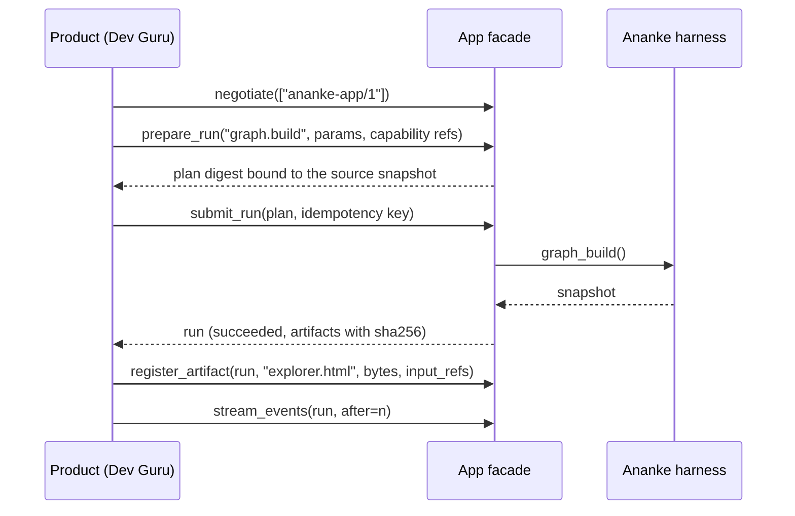

# App facade

Products built on Ananke, such as [Dev Guru](https://neo-pragnya.github.io/Dev-Guru/), don't call internal modules.
They use one narrow, versioned facade, `ananke.plexus.app.AppFacade`, either in-process or as JSON commands
(`ananke app …`). Every operation maps onto the real harness: run kinds call the existing `Ananke` operations, and
capability references go through the [provider port](../guides/capability-sources.md).



## Operations

| Operation | What it does |
| --- | --- |
| `negotiate(protocols)` | picks a protocol both sides speak (`ananke-app/1`); otherwise `UNSUPPORTED_VERSION`, with nothing installed |
| `capabilities()` | protocol, Ananke version, operations, run kinds (`graph.build`, `graph.impact`) |
| `resolve_capabilities(refs)` | exact identities and digests through the provider port |
| `prepare_run(kind, parameters, refs)` | a plan whose digest covers kind, parameters, resolved capabilities and the source snapshot |
| `submit_run(plan, key)` | runs it (or queues it with `start=False`) |
| `get_run(id)` | the authoritative state |
| `cancel_run(id)` | cooperative cancellation |
| `stream_events(id, after)` | events after a sequence number |
| `list_artifacts(id)` / `read_artifact(id, name)` | artifacts; reading re-checks the digest |
| `register_artifact(id, name, bytes, media_type, producer, input_refs)` | an external producer (a renderer) stores what it made |
| `register_failure(id, producer, message)` | an external producer reports that it failed |
| `validate_workflow`, `preview_workflow`, `compile_workflow`, `suggest_capabilities` | [workflow assembly](../guides/workflow-assembly.md); none of them runs anything |
| `code_view(path_prefix, kinds, query)` | a filtered slice of the latest code graph; inferred edges stay marked inferred |
| `read_source(path, start, end)` | lines of a source file with its digest; stays inside the workspace and refuses harness state, Git data and environment files |
| `architecture_view()` | the declared architecture and its drift from the code graph; never creates a model |
| `evidence_view()` | recent runs: state, completeness, plan digest and artifacts |

## Guarantees

- **States** follow the shared run-result contract: `queued → running → succeeded | failed | cancelled`.
  `complete` says whether every expected artifact was produced. A failure is a state with a structured warning,
  never a lost run.
- **Idempotency.** The same key with the same canonical request returns the same run. The same key with a different
  request is `IDEMPOTENCY_CONFLICT`.
- **Plans are bound to the source.** If the workspace changed after `prepare_run`, `submit_run` refuses with
  `STALE_PLAN` (retryable: prepare again). The snapshot is the Git commit plus a digest of uncommitted changes.
- **Ordered, resumable events.** Each event has `run_id`, a per-run `seq` that increases with no gaps, `type`, `at`,
  `schema` and `payload`. If retention dropped events after the sequence you ask from, the response includes the
  missed `gap` and the current `run`. A disconnected client doesn't stop a run.
- **Cooperative cancellation.** A queued run is cancelled and never starts. A finished run stays finished, gets an
  `ALREADY_FINISHED` note, and nothing already done is rolled back.
- **Artifacts are evidence.** Each has a SHA-256, size, media type, producer and input references. A tampered file
  is refused on read (`DIGEST_MISMATCH`). A producer that fails is recorded: the run turns `complete: false`, and an
  `artifact.failed` event says why.

## JSON commands

```bash
ananke app capabilities
ananke app run graph.build --key 2026-11-02-explore          # prints the run
ananke app run graph.impact --key k2 --params '{"changed_files": ["src/app.py"]}'
ananke app status run-…
ananke app events run-… --after 3
ananke app cancel run-…
ananke app artifacts run-…
ananke app read run-… graph-snapshot.json -o graph.json
```

Each prints one JSON document. Errors go to stderr as `{"error": {"code", "message", "retryable"}}`, with exit `75`
when retrying may help and `2` when it won't. Pass `--protocol` to state what the caller speaks.

State lives in `.ananke/app/` in the workspace (runs, events, artifacts and the idempotency index), as plain JSON.
