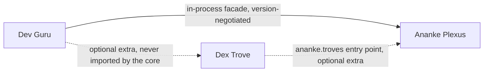

# Three-repository audit (ADR-0001)

**Status:** accepted · **Date:** 2026-11-01 · **Backlog task:** `ARC-AUDIT-3REPO`

Dev Guru (product and presentation), Ananke Plexus (harness and compute) and Dex Trove (reusable capability memory)
are being built as three repositories. Before writing contracts, the plan requires recording what the existing code
*really* exposes: pinned commits, interfaces, baseline tests, dependency direction and gaps. This page is that
record. The planned names in the design bundle are targets; everything below was read from source or observed by
running it.

## Decision

1. **Ananke is the only harness.** Dev Guru calls Ananke through one client port and never analyses code itself. Dex
   never imports Ananke or Dev Guru to publish or browse its catalog.
2. **Dev Guru starts on Ananke's existing Python facade** (`ananke.plexus.api.Ananke`) over an `in-process`
   transport. It negotiates the supported range explicitly (`ananke-plexus>=0.3.11,<0.4`), plus the specific
   capabilities it calls. An isolated-process transport and a local gateway come later. Exactly one transport is used
   per run, and failures are reported, never retried on another transport.
3. **The capability source port maps onto Ananke's registry**: learn, importers, sources, resolver and lockfile. It
   does not become a second authority. The registry stays the record of identity, versions, digests, trust and locks.
4. **Dex stays optional everywhere.** Ananke reaches Dex only through the `ananke.troves` entry point and the
   optional `[dex]` extra. Dev Guru declares `dex` as an optional extra and never imports `dex_trove` in its core
   (tested).

## Pinned revisions

| Repository | Revision audited | Python | Baseline at audit |
| --- | --- | --- | --- |
| Ananke Plexus | `v0.3.11` · `a7391347776e7c336f2cb9a76117a623645b1204` | `>=3.11` (CI 3.11 to 3.14) | 1,821 unit tests pass (1 skipped); acceptance 83 pass, 1 recorded known issue (CONDITIONAL); distribution scan PASS |
| Dex Trove | `v0.1.6` · `05cb07c2d19e61f995ae64154a65077195a71c11` | `>=3.11` | 50 unit tests; acceptance PROMOTE (36 scenarios, with site journeys) |
| Dev Guru | new: `f378dd3` (initial commit) → scaffold in this change | `>=3.11` | 23 unit tests; acceptance PROMOTE (dev and built wheel, Dex absent) |

Neither `ananke-plexus` nor `dex-trove` ships a `py.typed` marker, so type checkers treat them as untyped. Dev Guru's
mypy follows them explicitly for now; adding `py.typed` to Ananke is a small follow-up.

## What Ananke exposes today

### Facade (`ananke.plexus.api.Ananke`)

`Ananke.open(repository_root)` returns a facade whose methods return
`CommandResult(ok: bool, summary: str, details: dict[str, Any])`. The groups relevant to Dev Guru:

| Area | Methods | Notes |
| --- | --- | --- |
| Graph | `graph_build()`, `graph_query(needle)`, `graph_impact(changed_files)`, `graph_export(fmt)` | `graph_build` persists `.ananke/graph/metadata.json` and returns its path |
| Specs and BMAD | `create_spec(...)`, `plan`, `tasks`, `lock`, `validate`, `diff`, `converge`, `verify` | spec lifecycle, gates |
| Architecture | `arch_init/validate/diff/reconcile/render` | CALM |
| Runs | `run_start(spec_id)`, `run_status(run_id)`, `run_cancel`, `run_replay` | run state is JSON under `.ananke/runs/<id>/` |
| Registry | `.registry` → `Registry` | see below |
| Lifecycle | branches, issues, PRs, worktrees, Confluence, telemetry, evidence | SCM integrations |

`details` is an untyped dict, so results are summaries rather than typed models. Dev Guru reads typed data
directly from the owning service. For example, `graph_summary` calls `graph_build()` and then
`ananke.plexus.graph.service.load_graph`, which returns a `GraphSnapshot`.

### Graph model (`ananke.plexus.graph.models`)

`GraphSnapshot(snapshot_id, provider, nodes: list[GraphNode], edges: list[GraphEdge])`.

- `GraphNode(node_id, kind, name, path, provider, metadata)`.
- `GraphEdge(source, target, kind, origin, provider, confidence, source_location, snapshot_id)`.

`origin` is one of `extracted | inferred | ambiguous | declared`. Providers: `native`, plus optional `graphifyy` and
`code-review-graph` adapters behind the `GraphProvider` protocol (`build`, `impact`).

The native provider parses Python with `ast` and keeps only **top-level** functions and classes, `owns` edges, and
`imports` edges. It has no call edges, no methods and no notebooks. `snapshot_id` is a UTC timestamp, so two
builds of the same code differ.

### Registry (`ananke.plexus.registry`)

- Artifact kinds: `skill, agent, tool, workflow, evaluator, prompt, policy, bundle, runtime-profile`. There is no
  `instruction` kind; Dex maps instructions to `prompt`.
- Lifecycle `active | deprecated | yanked | quarantined | archived`; trust
  `unknown | discovered | verified | approved | restricted | quarantined`.
- Immutable versions in a content-addressed store, with digests, signatures (ed25519), channels, aliases and
  revisions. `register`, `promote`, `yank`, `deprecate`, `quarantine`, `set_trust` and `alias_set` are on `Registry`.
- Resolution: `Resolver` with `locked`, `highest-compatible`, `highest-approved`, `lowest-compatible`, `stable-only`
  and `exact` modes. Lockfile entries are `LockEntry(id, version, digest, source, kind, dependencies, ...)`, checked
  by `verify_lock`.
- Sources: federation priority `project → user → enterprise → public`. Remote sources are pull-only, and pulled
  versions arrive as `discovered` (trust is never inherited).
- Ingestion: `learn(registry, source)` through importers (`filesystem`, `framework`, `manifest`, `mcp`,
  `python_pkg`, `registry`, `rust_crate`, `vcs_archive`), with a secret scanner and permission review. Installed
  libraries plug in through the `ananke.troves` entry point, selected per project by `[troves.<name>]`.

### Execution, events and evidence

- `execution.plan.ExecutionPlan` / `ExecutionStep` with approvals, checkpoints (`save/load/resume_from_checkpoint`),
  compensation and a scheduler (`run_plan`, with concurrent steps).
- `workflows.Workflow` / `WorkflowStep` are project-authored argv steps with their own runner, a second, simpler
  workflow notion.
- `events.Event(event_id, event_type, run_id, timestamp, actor, payload, correlation_id, causation_id)` goes over an
  in-process `EventBus`. Events have no sequence number and no persisted, replayable log.
- Evidence bundles, SARIF output and retention (`evidence/`).
- Interfaces: the `ananke` CLI (166 commands), `apm`, and an MCP server speaking JSON-RPC 2.0.
- Plugins: entry-point groups `ananke.graph`, `ananke.backend`, `ananke.spec_provider`, `ananke.gate` and
  `ananke.lifecycle`.

## What Dex Trove exposes today

- **CLI** `dex`: `sources`, `learn`, `validate`, `list`, `search`, `show`, `install`, `license`, `notices`,
  `catalog`, `ananke sync`, `docs export`. This change adds `facets list|show|build|doc`, faceted `search` and
  Claude-safe `install`.
- **Data:** `trove/catalog.json` (every item's `dex.json`), `EXCLUDED.json`, `trove.lock.json`, per-item
  `ananke.yaml`. This change adds `trove/facets.json`. Items keep upstream bytes verbatim, with a `content_hash` and
  a SemVer `version`.
- **Integration:** the `ananke.troves` entry point (`dex_trove.paths:trove_root`) and `dex ananke sync`, which stages
  items and runs `ananke registry learn`.
- **Dependency direction:** Dex imports Ananke in one place only. `dex validate` *optionally* imports Ananke's
  `ArtifactManifest` for its strongest manifest check, and skips it when Ananke is absent. Catalog browsing and
  publishing don't need Ananke.

## Dependency direction (verified)

- Ananke never imports Dev Guru or Dex (Dex is found only through the entry point).
- Dev Guru's tests assert that `dex_trove` is never imported and that no Node runtime is needed.
- Dev Guru's acceptance suite runs from a built wheel in an environment *without* Dex.

## Reuse map: planned task → existing code → gap

| Backlog task | Reuse | Gap to close |
| --- | --- | --- |
| `AN-SOURCE-PORT` | `registry.sources` (federation), `registry.learn` + `importers.filesystem` (the local-directory provider), `registry.troves` | A source-neutral provider protocol: `discover / resolve / fetch / refresh / publish` with stable descriptors. Troves assume Dex's `catalog.json` shape. |
| `AN-INTERNAL-SKILLS` | `importers.filesystem` imports plain `SKILL.md` folders; learn's secret scanner and permission review | The sidecar format from the plan (source namespace, relative path, digest, declared requirements); explicit "unknown" metadata |
| `AN-CAPABILITY-LOCKS` | `lockfile.LockEntry` (id, version, digest, `source`), `verify_lock`, `ResolutionMode.LOCKED` | Lock entries keyed by **source-id + namespace + id**, so two sources' same-named skills stay distinct; `source` defaults to `local-registry` today |
| `AN-APP-FACADE` | `api.Ananke` (above) | A typed, versioned facade: capability listing for negotiation and typed results instead of `details: dict` |
| `AN-RUN-EVENTS` | `events.Event`, `EventBus`, `execution.state`, checkpoints | Idempotent submission, a sequence-numbered persisted event log, and a resumable stream |
| `AN-EXTERNAL-RENDERER` | entry-point discovery in `plugins.discovery` | A generic artifact-producer group and contract (input digest in, artifact + digest out), recorded as evidence |
| `ASM-A03` (compiler) | `ExecutionPlan`, `scheduler.run_plan` | One workflow notion: `workflows.Workflow` and `ExecutionPlan` overlap |
| Deterministic reports (`DG-OFFLINE-HTML`) | `GraphSnapshot` | A content-derived `snapshot_id` (or a separate digest) so identical input gives an identical report manifest |
| Graph breadth (Phase 4) | native provider, `graphifyy` and `code-review-graph` adapters | Call edges, methods and notebooks, so the explorer isn't limited to modules and top-level symbols |
| `DEX-MEMORY-RELEASES` | per-item `version` + `content_hash`, `trove.lock.json`, git history | Release receipts, deprecation metadata, v1 and v2 of an item side by side (today the trove holds only the latest) |
| `ASM-D01` to `ASM-D05` | done in Dex 0.2.0: taxonomy, facet sidecar, faceted search, site filters, education docs | Taxonomy landing pages and typed related edges (`ASM-D06`) |

## Dev Guru scaffold (`DG-PACKAGE`)

The repository is [Neo-Pragnya/Dev-Guru](https://github.com/Neo-Pragnya/Dev-Guru). Package `dev-guru`, module
`dev_guru` and command `devguru` are provisional; the names are free on PyPI and TestPyPI, and nothing is reserved.

- `dev_guru.client`: the port (`AnankeClient` protocol, `HarnessInfo`, `GraphSummary`), `connect(transport)` and
  the `in-process` adapter. Negotiation checks the installed version against the supported range and probes six
  capabilities, two of them required (`graph.build`, `graph.load`).
- `dev_guru.errors.GuruError` with stable codes: `HARNESS_MISSING`, `HARNESS_INCOMPATIBLE`, `CAPABILITY_MISSING`,
  `UNSUPPORTED_TRANSPORT`, `WORKSPACE_INVALID` and `HARNESS_FAILED`.
- `devguru doctor [--json]` reports the harness. `graph_summary(workspace)` runs **real** Ananke analysis; the tests
  use a fixture project, not a mock.
- The same tooling as Ananke and Dex: uv + hatchling, ruff, strict mypy, pytest, the capability-acceptance harness
  (byte-identical), `scripts/scan_dist.py` (byte-identical), and CI pinned to the same action SHAs.

**Next, in backlog order:** `AN-SOURCE-PORT` → `AN-INTERNAL-SKILLS` → `AN-CAPABILITY-LOCKS` → `AN-APP-FACADE`,
then `DG-CLIENT` → `DG-VIEW-MODELS` → `DG-CLI-SDK` → `DG-OFFLINE-HTML`. That leads to the Dex-free acceptance
path: an internal skill, a lock, a graph run and an offline HTML report.
